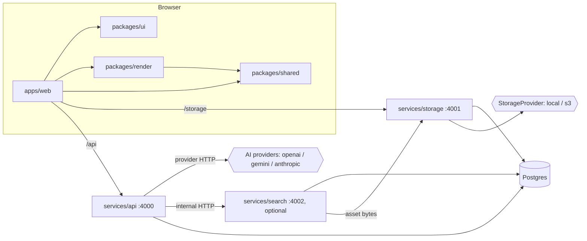
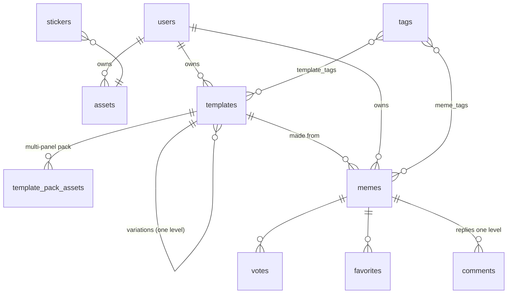

# memegen architecture

High-level system design: modules, how they connect, and the decisions that shape them. Setup and commands: [README.md](README.md). Rules for changing the repo: [AGENTS.md](AGENTS.md). Exact types live in `packages/shared`; this doc names them but does not repeat them.

## System overview

memegen is a React SPA backed by two small Node services, an optional search sidecar, and Postgres. The browser does all media work (decode, composite, encode). The servers store, validate, and index.

## Modules

| module | runs in | responsibility | depends on |
|---|---|---|---|
| `packages/shared` | browser + Node | Types, zod schemas, upload limits, pure layout/animation/panel logic, AI spec | — |
| `packages/render` | browser only | Decode → composite → encode for images, GIFs, video | shared |
| `packages/ui` | browser | Skinnable components and design tokens | — |
| `packages/server-kit` | Node | Config, Postgres, migrations, `AuthProvider`, HTTP helpers, asset rows, test helpers | shared |
| `services/storage` | Node | Asset upload/serve, content sniffing, probing, caps, storage providers | server-kit, shared |
| `services/api` | Node | Users, templates, memes, votes, comments, tags, stickers, stats, AI proxy | server-kit, shared |
| `services/search` | Node | Optional sidecar: CLIP embeddings of template images in a FAISS index (natural-language search, duplicate checks) | server-kit, shared |
| `apps/web` | browser | SPA: editor, template browser, gallery, profiles | ui, render, shared |
| `db/migrations` | Postgres | Append-only schema, applied in filename order | — |
| `scripts/` | Node/Bun | `run.sh` supervisor, seeds, snapshots, prod web server | all |
| `e2e/` | Playwright | Browser specs against isolated DB and ports | — |

Dependency rules:

- `packages/shared` is the single source of truth for contracts. Request bodies are `z.input` of its schemas, responses are `z.output`, so API, web, and e2e cannot drift.
- Servers never import `packages/render`. API runtime code never imports `services/storage` (tests may, as a dev dependency); shared asset-row access lives in `server-kit`.
- Nothing imports `services/search`: the API reaches it over HTTP (`services/api/src/search.ts`), and it reads asset bytes over storage's HTTP API.
- Web `pages/` import from `components/`, never from each other.

## Key decisions

### Rendering is client-side

- Servers never decode or encode frames. `packages/render` handles stills (canvas → PNG/JPEG), GIFs (`gifuct-js` → `gifenc`), and MP4/MOV (`mediabunny`/WebCodecs → H.264, audio passed through).
- Preview equals output: the editor stage, loop preview, and every export use the same `layoutText`/`drawText` (shared) and `composeFrame` (render). The stage's handles and transparency checkerboard are DOM/CSS over the canvas, so its Preview box (beside a template's title) just drops them to show the finished meme.
- Layout is stored in fractions of the media, so it is resolution-independent; text is rasterized at the size shown or exported.
- Trade-off: export speed depends on the client. A server renderer could reuse the same TS without changing the data model.
- One exception, not rendering: the search sidecar decodes template images (a GIF's first frame) to embed them. It never encodes or serves media.

### Template search is an optional sidecar

- `services/search` runs only with `SEARCH_ENABLED=true`. It loads CLIP (`Xenova/clip-vit-base-patch32` via transformers.js / ONNX Runtime, downloaded into `SEARCH_DATA_DIR` on first start) and keeps every image/GIF template's unit-length embedding in a FAISS inner-product index (cosine similarity). Videos are found by name and tags only.
- Postgres stays the source of truth: every request first syncs the index with `templates`, embedding only images it hasn't seen and adding or removing only the templates that changed (no rebuild per change). Embeddings are keyed by the asset's sha256 and cached on disk, so restarts, snapshot loads, and re-uploads cost nothing. No migration or trigger is involved.
- The index (`services/search/src/vector-index.ts`) is exact brute force up to `EXACT_LIMIT` (50k) vectors, about 2 ms a query at that size, and an HNSW graph past it. Exact stays the default because HNSW misses some true top-20 text matches even on a few hundred templates (text queries sit off the image distribution the graph is built from); image-to-image (duplicate) lookups keep full recall. Neither FAISS index deletes by key, so removals are tombstones that searches skip; the index is rebuilt from live vectors once tombstones pass a quarter of them, and when it crosses `EXACT_LIMIT`. faiss-node can't set HNSW's `efSearch`, so recall is tuned by fetching at least 64 candidates.
- Text search: the query is embedded as the mean of several captions ("a photo of a dog", …), each image's similarity to a neutral caption is subtracted (busy, text-heavy images otherwise top every query), and matches are scored by z-score across the library. The subtraction is folded into the query (`query − baseline`), and the library's mean and spread come from running first and second moments of the vectors (O(d²) per query, exact), so only the top matches are scored. A query returns nothing unless its best match reaches `TEXT_MIN_TOP_Z`, then every match from `TEXT_MIN_Z`. Thresholds are starting points in `services/search/src/catalog.ts`.
- `GET /api/templates?q=` ranks tag matches, then name matches, then image matches, each template once; an image match on a variation finds its top-level template, and visibility and filters apply to all three.
- Duplicates: `GET /api/templates/duplicates` lists templates with the same bytes (always), then image matches at cosine ≥ `DUPLICATE_MIN_SIMILARITY` (0.92: re-encodes and resizes score above, different pictures of one subject below). The Template Editor shows them before a new template is saved.
- Search is an extra: when the sidecar is off, slow, or failing, the API logs it and falls back to tags and names (text queries time out after 3 s).
- The transport is plain JSON over HTTP behind `X-Internal-Token`, like `/internal/*`; no web proxy forwards to it.

### Storage is pluggable and immutable

- `StorageProvider` (`put`/`get`/`delete`) with a registry; built-ins `local` and `s3`. Each asset row records its provider and key, so providers coexist.
- Asset content is immutable and served with Range support and immutable caching.
- Content type is sniffed from magic bytes, never trusted from the client.
- Upload caps (size, dimensions, frames per kind) default in `packages/shared/src/limits.ts`, take env overrides in `server-kit/src/config.ts`, are pre-checked by the client, and enforced by storage on every write, including rendered outputs. Probing is pure JS (no server ffmpeg).

### Derived data lives in the database

Triggers keep derived state consistent across every write path (API, seeds, snapshot restore): template `kind`, default owners, vote tallies, usage logs (`template_uses`, `sticker_uses`), and hierarchy/reply-depth limits. Views handle tag inheritance. Consequence: snapshots are `pg_dump`s, not row replays.

### Access rules are defined once

- Visibility rules (listed, visible, openable) live in `services/api/src/rows.ts`, with the JS form `isListed` in shared.
- Auth goes only through `AuthProvider` (`server-kit/src/auth.ts`), installed per service via `installAuth`; routes read `c.get("user")`. The current `HeaderAuthProvider` (`X-User-Id`) is a placeholder and **not secure**; a real provider replaces it without touching routes.
- Internal-only data (e.g. `negativeHScore`) is served under `/internal/*` behind `X-Internal-Token`, which no web proxy forwards.

### AI is a stateless proxy

- The API forwards requests to the user's chosen provider with the user's own key (`X-AI-Key`) and stores nothing. Kept results re-enter as ordinary uploads, so caps, sniffing, and the template flow are unchanged.
- Providers are adapters in `services/api/src/ai/` behind `AiProvider` (text edits) and `AiImageProvider` (image edits), selected via a registry.
- Text edits use a versioned spec (`AI_EDIT_SPEC` in `packages/shared/src/ai.ts`): the model returns a list of actions (`UPDATE_IMAGE`, `ADD_TEXT`), which the server normalizes and the browser applies.
- Provider errors map to 422/429/502, never 401 (which the client treats as its own session ending).
- Provider keys and settings stay in the browser (`localStorage`).

### UI is skinnable

- All web UI is built from `@memegen/ui`; app CSS is layout-only and reads tokens.
- A skin is token overrides plus optional component replacements and layout hints. Only one arrangement renders at a time, so test ids stay unique. See `packages/ui/README.md`.
- Dark mode is a per-skin variant (`Skin.dark`), not a second token set: the app keeps the choice per user in `localStorage` and turns it on through `SkinProvider`, which sets `data-theme="dark"` on `<html>` for skins that have one. Today only `painted` does; skins without a variant ignore it, and the profile's Settings tab hides.

### Migrations are the schema version

Migrations are append-only and never edited once applied. Snapshots record their applied migrations; loading restores the snapshot schema, then migrates forward.

## Data model

- **Asset**: stored bytes (`image | gif | video | font`). All media, fonts, outputs, and stickers are assets.
- **Template**: base media plus default layers. `kind` is `single`, `gif` (GIF or video), or `multi` (an image pack laid out as panels). New media enters the system only as a template. Built-ins belong to the reserved `memegen` user.
- **Meme**: always made from a template; stores its own layers (or panels), source, and rendered output asset, so it can be re-edited. Saved = row exists; posted = `posted_at` set; listed = posted and public.
- **Layer**: discriminated union `text | image` sharing placement, opacity, a visibility window, and keyframes. Animation rules are pure functions in `packages/shared/src/animation.ts`.
- **Tag**: `topic | team`; memes inherit their template's tags, variations roll up to the parent.
- **Votes/stats**: one ±1 vote per user per meme; user stats and leaderboard share one SQL definition; badges are computed client-side from public stats. Each badge is one stat's tier (`BadgeDef.stat`, `.tier`, via `badgeFor`): a star in the tier's color (`--ui-color-tier-*`) follows that stat's figure everywhere (leaderboard, user search, profile), and profile stat tiles take the tier's color as their outline. The leaderboard's stat column headings are its sort buttons; `LEADERBOARD_SORTS` is in column order.

## Interfaces

All JSON unless noted. Errors: `{ error: string, details?: string[] }`. Shapes are the types in `packages/shared`.

### storage (`:4001`, web proxy `/storage`)

| route | purpose |
|---|---|
| `GET /health` | liveness |
| `GET /limits` | `UploadLimits` |
| `GET /providers` | default and available providers |
| `POST /assets` | multipart upload → `Asset`; 413/422 with cap violations |
| `GET /assets`, `GET /assets/:id` | list (by `kind`) / fetch `Asset` |
| `GET /assets/:id/content` | bytes, Range supported |
| `DELETE /assets/:id` | owner or internal token; 409 if referenced |

### api (`:4000`, web proxy `/api`)

| area | routes |
|---|---|
| health | `GET /health` |
| session/me | `POST /api/session`, `GET /api/me`, `GET /api/me/activity`, `GET /api/me/favorites` |
| users | `GET /api/users`, `GET /api/users/:username`, `GET /api/users/:username/memes`, `GET /api/users/:username/templates`, `GET /api/leaderboard` |
| templates | `GET/POST /api/templates` (`q` searches tags, names, then images), `GET /api/templates/count`, `GET /api/templates/hot`, `GET /api/templates/duplicates`, `GET/PATCH/DELETE /api/templates/:id`, `GET /api/templates/:id/usage`, `POST /api/templates/:id/tags` |
| memes | `POST /api/memes`, `GET/PATCH/DELETE /api/memes/:id`, `POST /api/memes/:id/post`, `PUT /api/memes/:id/vote`, `PUT /api/memes/:id/favorite` |
| comments | `GET/POST /api/memes/:id/comments`, `DELETE /api/comments/:id` |
| gallery | `GET /api/gallery` (period, sort, tag, search) |
| tags | `GET/POST /api/tags`, `GET /api/tags/:slug` |
| stickers | `GET/POST /api/stickers` |
| AI | `POST /api/ai/edit` (spec actions), `POST /api/ai/images` (image bytes); multipart, `X-AI-Key`, nothing stored |
| internal | `GET /internal/users/:username/stats` (`X-Internal-Token`) |

API layout: `app.ts` wires auth and errors; each `routes/*.ts` exports a `register(app, …)`; shared guards in `access.ts`; row mapping and visibility in `rows.ts`.

### search (`:4002`, optional, API only)

| route | purpose |
|---|---|
| `GET /health` | liveness and indexed template count |
| `POST /search` | `{ q, limit }` → `SearchHits` (z-scores), `X-Internal-Token` |
| `POST /similar` | `{ assetId, limit }` → `SearchHits` (cosine), `X-Internal-Token` |

## Runtime and config

- Node ≥ 24.2 runs server `.ts` via type stripping; Hono for HTTP; `postgres` (porsager) for SQL. Bun installs and runs scripts; Vite builds the web app.
- `run.sh <config> <command>` is the single entry point; configs are literal `KEY=value` files.
- `scripts/run.ts` supervises migrate → storage → API → (search, when `SEARCH_ENABLED=true`) → web. The process list (`scripts/services.ts`) is shared with Playwright.
- In prod, `scripts/serve-web.ts` serves the SPA and proxies `/api` and `/storage` (never `/internal`).
- `MODE` is baked into the web build; anything other than `dev` builds as prod. `MODE=prod` refuses destructive and dev-only commands and requires real secrets.
- `INTRO` (`basic` | `party` | `nyan`, default `basic`) is baked into the web build the same way and picks the sign-in page's intro; `vite.config.ts` fails the build on any other value. In dev, the sign-in page's dev tools preview the others (kept in `localStorage`, ignored in prod, like skins). Nyan cat is two images, the cat alone and one repeatable wave of rainbow: the rainbow is fixed in place and revealed behind the cat as it flies, so it can run any length and never slides.

## Data sets and snapshots

- One zip format (`scripts/snapshot.ts`) serves prod backups, the dev sample, and starter content: a manifest, a `pg_dump`, and asset bytes.
- Saves are read-only and consistent (one `repeatable read` transaction). Loads target a clean system, verify everything first, then restore and migrate.
- Datasets are committed as code, not dumps: mock (e2e), sample (dev), starter (shipped). Their memes are rendered at seed time by `@memegen/render` in headless Chromium.

## Testing

- `node --test`: shared logic and service behavior via `app.request()` against a fresh `memegen_test`.
- Playwright: real servers on separate ports against a fresh `memegen_e2e`, in branded Chrome (needed for H.264 in WebCodecs). AI calls hit a local stub (`startAiStub`). The search sidecar runs for real, with the model and embedding cache shared with dev.
- Search: API tests inject a `TemplateSearch` to pin ranking, visibility, and duplicate merging; sidecar tests run the real CLIP model against the test database.
