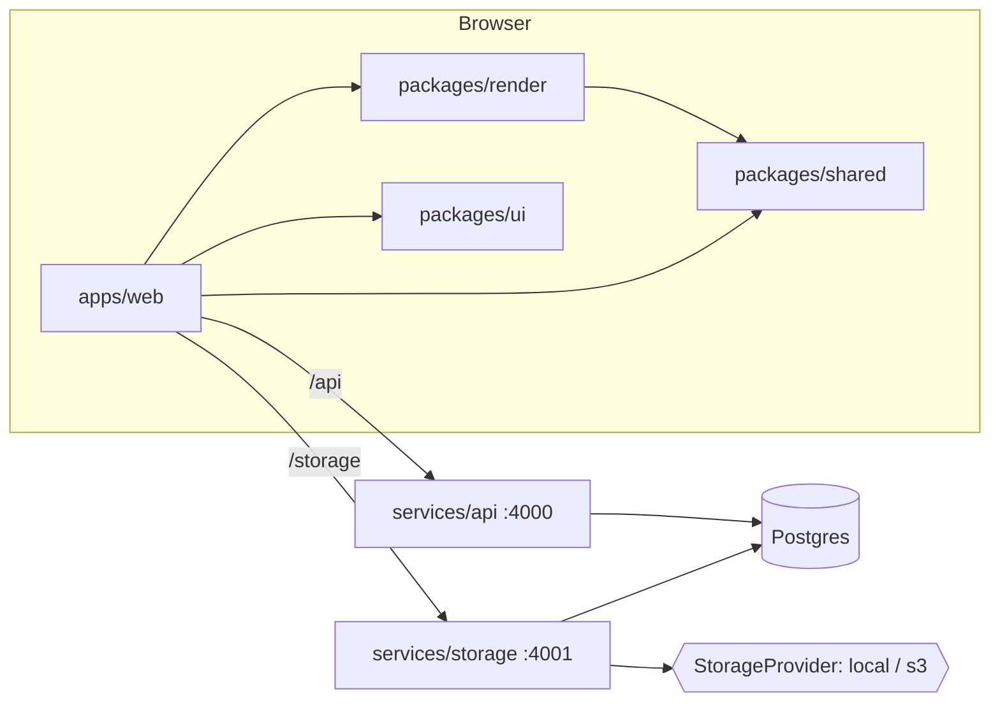

# memegen architecture

Design decisions, data model, and service contracts. Setup and commands: [README.md](README.md). Agent rules: [AGENTS.md](AGENTS.md).

## Components

```
apps/web            React + Vite SPA: editor, template browser, gallery, profiles
packages/ui         Skinnable React components + design tokens (see its README)
packages/render     Browser render engine: decode → composite → encode
packages/shared     Types, zod schemas, upload limits, animation + text layout (used everywhere)
packages/server-kit Node server plumbing: config, Postgres, migrations, auth, HTTP helpers, asset rows
services/storage    Asset service: pluggable providers (local, s3), probing, caps
services/api        Users, templates, memes, votes, comments, tags, stickers, gallery, stats
db/migrations       Append-only SQL migrations, applied in filename order
scripts/            run.sh supervisor, seeds, snapshots, prod web server
e2e/                Playwright specs + fixtures (isolated DB and ports)
```



## Rendering happens in the browser

- Servers store, validate, and index. They never decode or encode frames.
- `packages/render` pipelines:
  - image → canvas → PNG/JPEG
  - GIF → `gifuct-js` decode (with disposal compositing) → `gifenc`, per-frame delays kept. Delays under 20 ms play as 100 ms, like browsers; render and storage share `gifFrameDelayMs`.
  - MP4/MOV → `mediabunny` (WebCodecs) decode → per-frame composite → H.264 MP4; audio passed through.
- Preview == output: the editor stage, the loop preview, and every export (stills, GIF, and MP4) call the same `layoutText`/`drawText` (`packages/shared/src/text.ts`) and `composeFrame`. MP4 frames are mediabunny `VideoSample`s, which draw themselves, so `composeFrame` takes either an image source or a draw callback. `composeFrame` also returns each layer's `LayerBox` for hit-testing.
- Resolution: all layout is in fractions of the media, and text is rasterized at the size it is shown or saved, never at source size and then stretched. Still exports render at least `STILL_EXPORT_MIN_EDGE` (1200 px) on the long edge, capped by the image cap: `exportMeme` takes the limits, scales the media to the target width first, then measures the band at that width, so the media is never stretched to fill what the band leaves. GIFs and videos export at native size.
- Trade-off: export speed depends on the client and WebCodecs support. A server fallback could reuse the same TS later without changing the data model.

## Layers

- `Layer` is a zod discriminated union on `type`: `text` or `image`. Both share `id`, `name`, `angle`, anchor `x,y`, `opacity`, a visibility window, and keyframes, so placement, dragging, tracks, and every `animation.ts` rule apply to both. Types are `z.output` of the schemas, and request bodies (`CreateMemeInput`, `CreateTemplateInput`, …) are their `z.input`, so the API, the web client, and e2e can't drift. Migration 011 tagged pre-image layers as `text`.
- `TextLayer`: a box (center anchor + `maxWidth`/`maxHeight`, fractions of the media, 0.05..1). `fontSize` is a max: text wraps at the box width and shrinks until it fits. Raising the max size in the editor also grows the box height (`growTextBox`, never shrinks it; a box inside the media stays inside by moving its anchor) so the larger text actually shows; the selected box has corner handles that resize it about the opposite corner. `textStyle` is `upper | lower | none | mock`. Stroke width is a fraction of font size.
- `ImageLayer`: a still image asset drawn whole at its own aspect ratio, `width` a fraction of the media width (0.02..2), never cropped or stretched. Size and angle are static. Only the anchor and opacity animate.
- `name` labels a layer in the editor and is never drawn. Only the Template Editor renames layers, so a template's default names carry into its memes.
- Image layers are added by upload or paste, pre-checked against the image caps (stills only). Layer images and multi-panel pack images go through one loader, render's `loadAssetImages` (`AssetImages` by asset id): asset content is immutable, so each is decoded once per page and kept for the page's lifetime, shared by every editor and export, never closed. The API rejects image layers whose asset is missing or not a still image, and storage refuses to delete a referenced asset (409).
- Stickers (`stickers`, migration 012) are a shared library of PNGs ≤ `STICKER_MAX_DIMENSION` (512 px). A placed sticker is an ordinary `ImageLayer` on the sticker's asset, so the layer model, drawing, and API checks are unchanged. The PNG/size rule is a product rule, not an upload cap: a constant in `limits.ts` (`stickerViolations`, shared by client and API), with no env override. Owner-less stickers belong to `memegen`. Built-in stickers are seeded in dev only (`SEED_STICKERS_FROM`).
- Sticker usage (`sticker_uses`, migration 013) mirrors template usage: a trigger on `memes` logs `created` when a saved meme first carries a sticker and `posted` when it's posted, once per meme, sticker, and kind. Unsaved edits don't count. `GET /api/stickers` ranks by posts, then saves, then newest.
- Top section (caption memes): the one `TextLayer` with `topSection: {height}` is a white band above the media with black Arial text. It lives in `layers` (no column, API field, or migration). `height` is the one-line band height as a fraction of the media width (0.1..1, default 0.2). The font size is a fraction of that height, and each extra wrapped line grows the band. Its x/y are fractions of the band, while other layers stay fractions of the media, so toggling it never moves them. The band height depends on wrapping, so `composedSize` measures it at the width drawn, the same way for the stage, the preview, and every export. The editor pins it as layer 0: `canMoveLayer`/`moveLayer` in `section.ts` decide both the reorder and the disabled buttons. Outputs still pass the upload caps.

## Animation

- Per layer: visibility window `start`/`end` in seconds (`null` = unbounded), and `keyframes[] {t, x, y, opacity}` interpolated linearly and clamped at the ends. No keyframes = static layer.
- The editor shows every decoded frame. Windows are edited in frames (`windowFrames.ts`): `end` stores the last shown frame's start time, matching `isVisibleAt`. The clip's first/last frame stores `null`, and edges are clamped so a window can't invert.
- Every edit rule is a pure function in `animation.ts` that the editor only applies: `placeAt` (static layers move, animated ones get a keyframe at the current time), `addKeyframeAt`, `removeKeyframe` (the last one becomes the static position), `clearAnimation`, `setWindow`, `resizeImage`, `rotateTo`.
- Anchor clamping accounts for `above` (canvas above the layer's area, i.e. the top-section band), so layers can reach the top of a tall band. The schema allows anchor y down to `ANCHOR_Y_MIN` (-10).
- The GIF/video loop preview uses the export compositor and timing, skipping frames that decode too slowly rather than slowing the clock.

## Storage

- `StorageProvider` (`put`/`get(range?)`/`delete`) with a factory table in `providers/registry.ts`. Built-ins: `local` and `s3` (any S3-compatible endpoint). A new provider is one table entry.
- Each asset row records its `provider` and `storage_key`, so providers coexist and the default can change without migrating files.
- Asset kinds: `image | gif | video | font`. Content type is sniffed from magic bytes, never trusted from the client. `SUPPORTED_TYPES` in `packages/shared` is the single list of accepted types.
- Content is served with Range support. A row whose bytes are missing answers 404.
- Asset row types and mapping (`AssetRow`, `toAsset`, `findAssetRow`) live in `server-kit`, so the API never imports the storage service.

### Upload caps

Enforced by storage on every write. The client pre-checks with the same `limitViolations`. Rendered outputs pass the same caps.

| kind  | max longest edge | max frames | env |
|-------|------------------|------------|-----|
| any   | 20 MB file size  | —          | `MAX_UPLOAD_BYTES` |
| image | 4096 px          | —          | `MAX_IMAGE_DIMENSION` |
| gif   | 1024 px          | 500        | `MAX_GIF_DIMENSION`, `MAX_GIF_FRAMES` |
| video | 1920 px          | 1800       | `MAX_VIDEO_DIMENSION`, `MAX_VIDEO_FRAMES` |

Probing is pure JS (no server ffmpeg): `image-size`, a GIF block walker, and `mediabunny` for MP4/MOV.

## Templates

- One level of hierarchy: `templates.parent_id` (template → variations), enforced by a trigger. Variations are created only through the API.
- `default_layers` seed the editor. Memes keep their own layers, so editing a template's defaults never changes existing memes.
- Every template has an owner. Built-ins belong to the reserved `memegen` account (a trigger fills null owners via `memegen_user_id()`), and `memegen` can't be used as a login name.
- `kind` (`single`, `gif` (GIF or video), or `multi`) is stored (migration 010) and set by a `before insert` trigger from what the row is made of, so every write path agrees. It never changes on update. The editor routes on it.
- New media enters only as a template: upload → Template Editor (`/create?newTemplate=<assetId>`) → `POST /api/templates` with the placed boxes as `defaultLayers` and tags as base tags. Owners edit name and defaults at `/create?editTemplate=<id>`.

### Multi-panel templates

- An image pack plus default panels instead of one media file. `Template.panels = {layout, grid, mirror, fontSize, pack, defaultPanels}`. A meme stores `Meme.panels = {layout, grid, mirror, fontSize, panels}` with `layers: []`. Each panel is `{id, assetId, text}` referencing a pack image.
- Layouts: `vertical` (rows of caption | image) or `horizontal` (columns of caption over image), with 1..`MAX_PANELS` (12) panels. `mirror` swaps each caption and image (image | caption, image over caption) without changing the size. Memes may change the layout and add, remove, reorder, or re-point panels.
- Pack images are never cropped or resized, only scaled to a shared width (vertical) or height (horizontal). Captions are uniform per set: `grid`, `mirror`, and `fontSize` apply to all panels. The grid is inner dividers only (`panelRules`: between captions and images and between panels, never the outer edge). Migration 014 stored `mirror: false` on earlier panels.
- Geometry (`packages/shared/src/panels.ts`) and drawing (`composePanels`/`exportPanels`) are shared by stage and export. Exports are JPEG at `PANEL_EXPORT_UNIT` (600) px per image, shrunk under the image cap.
- The template's `asset` is a client-rendered cover, so everything that shows a template image needs no special case. Editing the defaults replaces the cover.
- `template_pack_assets` holds the pack. Packs only grow: memes reference pack images by id, so `PATCH` rejects removals. The API checks each meme panel against its template's pack.

### Usage ("hot")

- `template_uses` is an append-only log written by a trigger on `memes`: `created` when a meme is made, `posted` when posted. Each row stores `root_template_id`, so variations count toward their parent. `meme_id` is `on delete set null`, so history survives deletes.
- Hot = `created` uses in the period, tie-broken by posts. `useCount` is all-time. `/usage` gives a zero-filled series.

## Tags

- `tags(slug, name, kind topic|team)` with `template_tags` and `meme_tags`. Names normalize via `tagSlug`. An unknown slug creates a `topic` tag.
- Inheritance in SQL views: `template_tag_matches` rolls variations up to the parent, and `meme_tag_matches` matches a meme by its own tags or its template's. `Template.tags`/`Meme.tags` show only direct tags.
- Template tags are base (set at creation, never removed via API) or added (any signed-in user). `baseTags ⊆ tags`.
- Meme owners set meme tags. New memes start with the template's tags. Removing one only affects `Meme.tags`: inheritance still matches.
- Trade-off: no removal path for added template tags yet (no moderation).

## Memes, visibility, search

- Every meme is made from a template (`template_id not null`, `on delete restrict`). A meme stores its template, source asset, rendered output asset, and layers (or panels), so it can be re-edited.
- Saved = row exists. Posted = `posted_at` set. `visibility` is `public` or `private`.
- Listed (gallery, public profiles) = posted and public. Votes, favorites, and comments require listed. Opening by id requires public or owned.
- These rules live once in `services/api/src/rows.ts` (`memeListed`, `memeVisibleTo`, `memeOpenTo`, `templateVisibleTo`, `requireListed`). The JS form of listed is `isListed` in `packages/shared`, used by `requireListed` and the web app.
- Search (`GET /api/gallery?q=`) matches case-insensitively, with LIKE wildcards taken literally, on meme title, template or parent name, tags (including inherited), and author.
- Feeds lay memes out in justified rows (`justifyRows`) at native aspect, never cropped. This is JS because rows must both shrink and grow to fill the width. The rows sit in the app's own `.meme-grid` div, not ui `MediaGrid`: skins may restyle `MediaGrid` (Studio's masonry), which would fight a layout the app computes.

## Votes, stats, badges

- `votes(user_id, meme_id, value ±1)`, one per user per meme. A trigger maintains `memes.upvotes/downvotes`, and `score` is generated.
- Posting casts the author's upvote (Reddit-style), in the API only when the meme becomes listed (first post of a public meme), so a removed self-vote stays removed. Seeds write votes directly and get none.
- Votes double as the owner-only activity feed (`GET /api/me/activity`). Favorites are a separate table.
- Popular = listed memes posted in the period, by score then recency. Recent = all-time recency.
- User stats over posted memes: `memeCount`, `highScore`, `hScore` (largest h with h memes scoring ≥ h). `negativeHScore` (h memes ≤ −h) is internal only, at `/internal/users/:username/stats` behind `X-Internal-Token`. The web proxy never forwards `/internal`.
- One SQL definition serves profiles and the leaderboard.
- Badges are config in `packages/shared/src/badges.ts`, computed client-side from public stats, so they can't leak internal stats. Each stat shows only its highest tier.

## Comments

- Top-level comments plus one level of replies (enforced by a trigger). Only listed memes take comments.
- The comment author or the meme owner can delete. A comment with replies is blanked (`deleted: true`) to keep the thread shape. Otherwise it is removed, along with a blanked parent left with no replies.

## Auth

- Placeholder. `POST /api/session {username}` finds or creates a user, and the client sends `X-User-Id`. **Not secure**: anyone can act as anyone.
- Routes get the user only through `AuthProvider` (`packages/server-kit/src/auth.ts`), so a real provider replaces `HeaderAuthProvider` without touching routes. Both services call `installAuth(app, auth)`, which resolves the user once per request; handlers read it with `c.get("user")`.
- The web app is sign-in only: with no stored user, every URL renders the sign-in page, then the app at that same URL. Components can therefore assume a user. The API still serves anonymous reads. The gate is UI, not access control.
- The client keeps the user in a `memegen.user` cookie (one year). The server never reads it. A 401 on a request that carried `X-User-Id` drops the cookie.
- `MODE` is baked into the build (`__MEMEGEN_MODE__`). Anything but `MODE=dev` builds as prod, so the dev login never ships by accident. Prod shows a "Sign in with SSO" placeholder.

## AI images and captions

- `POST /api/ai/images` sends a prompt and a background image to an image model and returns the result's bytes. Nothing is stored: a result the user keeps is uploaded like any other new media (`/create?newTemplate=`), so caps, sniffing, and the template flow stay the same. Servers still never decode or encode: the API only checks magic bytes (`sniff`, shared with storage) on the way in and out.
- `POST /api/ai/captions` reads a description: the user's text, the template's own text boxes, and optionally the media go to a text model (OpenAI `/chat/completions` with a strict JSON schema, Gemini `generateContent` answering JSON). The model splits the meme's text into captions, decides where each goes, and pulls out any change the description asks for to the picture itself as `modification` (an image-edit prompt, or null). The template's boxes are hints, not slots: the model may use them or pick its own positions. The server is the one place output becomes an `AiCaptionsResponse` (`normalizePlacement`): boxes clamped into the media, empty or malformed captions dropped, at most `AI_CAPTIONS_MAX` kept, the modification trimmed and capped; neither left is a 502. Nothing is stored: the client turns captions into text layers.
- Providers are adapters behind `AiProvider` (`services/api/src/ai/`: `edit` for images, `caption` for placement, one shared caption prompt and schema in `captions.ts`), one per id in `AI_PROVIDERS` (`packages/shared/src/ai.ts`): `openai` (`/images/edits`, GPT Image) and `gemini` (`generateContent`, Nano Banana). A new provider is one adapter, one registry entry, and one list entry.
- Bring your own key: users save provider API keys under their profile's AI keys tab. Keys stay in that browser (`localStorage`, per memegen user) and go along in `X-AI-Key` on each request. The server forwards a key and never stores or logs it, so keys never reach the database or snapshots. Trade-off: keys don't follow a user to another browser. Real OAuth isn't offered: OpenAI and Gemini API keys have no end-user sign-in, and Adobe's Firefly API supports only org server-to-server credentials.
- The Create page's Creator has one Describe field. It starts on a random browsable template (multi-panel ones skipped), drawn on a canvas with the export's compositor, with the template's top and bottom text described as `top text: …` / `bottom text: …` (the caption prompt treats such labels as positions and drops them). Create sends the description (if any) to `/api/ai/captions` with the template's still image; a returned modification then goes to `/api/ai/images` with that image. An edited image is uploaded as new media and opens the Template Editor (`?newTemplate=`); otherwise the template itself opens (`?template=`). The captions travel in history state (`{captions}`, validated against `aiCaptionSchema` on arrival) and replace the starting text layers, keeping the look of the template's first text box (font, size, colors, style). A reload keeps them; a shared link does not. GIF and video templates take placed text, but a modification for one is refused.
- Provider errors never come back as 401, which the web client treats as its own session being rejected: a refused key or prompt is a 422 with the provider's reason, rate limits stay 429, and anything else is a 502. Both endpoints share this mapping.
- Tests use `startAiStub` (`server-kit/testing`), a local server speaking both wire formats (image edits, and caption JSON: `mod:` lines become the modification, every other line a caption with any `<position> text:` label dropped, spread top to bottom); e2e points `OPENAI_BASE_URL`/`GEMINI_BASE_URL` at it.

## UI and skins

- All web UI comes from `@memegen/ui`: typed components over native controls, so a11y, automation, and platform behavior are identical in every skin. App CSS is layout-only and reads tokens.
- A skin is `<html data-skin>` plus CSS token overrides, optional whole-component replacements (`Skin.components`), and one layout hint (`Skin.layout.filters`), which moves controls without duplicating them, so test ids stay unique. Details: `packages/ui/README.md`.
- On wide screens the header shares the shell's columns through layout tokens (`--ui-shell-gap`, `--ui-shell-padding-*`, `--ui-main-padding-inline`): the wordmark sits over the side column and the search starts where the main content does, in every skin. The wordmark keeps its skin size and shrinks only to fit the side column. That fit needs the wordmark's width in ems, which `Header` measures. CSS can't measure text.
- Narrow screens (≤ 760px) get one header row: the wordmark's first letter (its swatch scales down with the box), the search, and an account dropdown (Signed in as, Profile, Sign out). Below it sits one row with Create and a Gallery dropdown (Recent, Popular, Leaderboard). Feed filters move beside the page title, and the tag list is not shown. The app picks what to render with `useNarrowScreen()` (the same breakpoint as the CSS). Only one arrangement is ever rendered, so test ids stay unique.
- Licensed fonts (Adobe Clean, Radlush) are never bundled. They're used only when installed, with OFL fallbacks.
- Prod is locked to `default`. In dev, skins are switched from the sign-in page's Dev tools panel.

## Code layout

- API: `app.ts` wires auth, errors, and `routes/*.ts` (`register(app, sql)`). Shared loaders/guards are in `access.ts`. Row types, base selects, mappers, and batched child loading (`withVariations`, `nest`) are in `rows.ts`. Schemas come from `@memegen/shared`.
- Web: `pages/` are route screens and import only from `components/`, never each other. Data goes through `useAsync` (one value, drops stale results), `usePaged` (offset lists), and `useAction` (mutations; each run gets an `AbortSignal` that aborts on `cancel()` or unmount, so leaving cancels an export or upload in flight). A list that ends the page infinite-scrolls. Lists with content after them, and meme feeds, use "Load more".

## Testing

- `node --test`: pure shared logic plus storage/API behavior via `app.request()` against a fresh `memegen_test` schema.
- Playwright: real servers on separate ports against a fresh `memegen_e2e`. Exports are checked with `ffprobe`. Runs in branded Chrome, because Playwright's Chromium lacks H.264/AAC for WebCodecs.
- Datasets are committed as code, not DB dumps (dumps go stale with migrations and can't carry media):
  - Mock (`e2e/mock/data.ts`): e2e only, with generated media. `MOCK_EXPECT` rankings and stats are hand-written as an independent oracle.
  - Sample (`scripts/sample/data.ts`): the dev site, using the jacebrowning templates.
  - Starter (`scripts/starter/data.ts`): example memes owned by `memegen`, shipped as a snapshot.
- Sample and starter memes are rendered at seed time by `@memegen/render` in headless Chromium, with assets served from the store via `page.route` (offline, no running services). Rendering finishes before any DB write.
- Specs share one seeded DB (retries included): names they create go through `scoped()` and must be distinct across specs, and vote assertions are relative. They wait on state markers (`stage-canvas[data-ready]`, `timeline[data-complete]`), never sleeps.

## Snapshots

- One zip format serves prod backups, the dev sample, and starter content (`scripts/snapshot.ts`):
  - `manifest.json`: format, label, source, applied migrations, row counts, and every file's size and sha256
  - `db/memegen.dump`: `pg_dump --format=custom --no-owner --no-acl`
  - `db/schema.sql`: readable schema, never loaded
  - `assets/{fonts,stickers,templates,memes,uploads}/<name>--<id8>.<ext>`: uncompressed bytes. Loads find files via the manifest, never by name.
- A dump, not a row export: replayed inserts would re-fire the triggers behind usage logs, vote tallies, `kind`, and owners. `pg_restore` creates triggers after loading data, so derived rows come back exactly as saved.
- Versioning is the migration list: a load restores the snapshot's schema, then migrates. Unknown migrations (newer code) or another `SNAPSHOT_FORMAT` are refused. This is why migrations are never edited once applied.
- Save is read-only and consistent: one `repeatable read` transaction exports a Postgres snapshot shared by both dumps, the row counts, and the asset list. Any missing or mismatched asset fails the save, listing all of them, and leaves no zip.
- Load targets only a clean system (no tables, or migrations only with no users or assets). It verifies everything before writing, uploads bytes to the default provider, restores in one transaction, repoints asset rows to the default provider, checks row counts, then migrates.

## Runtime and config

- Servers: Node ≥ 24.2 running `.ts` via type stripping (erasable syntax only), Hono, and `postgres` (porsager). Bun installs packages and runs scripts. Vite builds the web app.
- `run.sh <config> <command>` is the single entry point. Configs are literal `KEY=value` files (no shell expansion).
- `MODE=prod` guards: refuses sample seeding, `dev`, `reset`, `test`, `e2e`, and `snapshot load --replace`. It also requires a non-dev `INTERNAL_TOKEN` and a real `DATABASE_URL`, and masks secrets in `config`.
- `scripts/run.ts` supervises migrate → storage → API → web (`--watch` or `--prod`), prefixes output per process, and stops everything when one exits. The process list in `scripts/services.ts` is shared with Playwright's `webServer`.
- `scripts/serve-web.ts` (prod) serves the SPA with fallback and immutable `assets/`, and proxies `/api` and `/storage` like Vite. It never proxies `/internal`.
- Proxies target `localhost:${API_PORT}`/`${STORAGE_PORT}`. `API_URL`/`STORAGE_URL` are overrides for split hosts only.

## Service contracts

All JSON. Errors: `{ error: string, details?: string[] }` with 4xx/5xx (validation issues or cap violations, human-readable).

### storage (`:4001`, web proxy `/storage`)
| method | path | notes |
|---|---|---|
| GET | `/limits` | `UploadLimits` |
| GET | `/providers` | `{ default, available[] }` |
| POST | `/assets` | multipart `file`, optional `name`; `X-User-Id` sets owner. 201 `Asset`; 413/422 `{error, details: violations[]}` |
| GET | `/assets?kind=&offset=&limit=` | `Page<Asset>` (fonts sorted by name; the editor's font list) |
| GET | `/assets/:id` | `Asset` |
| GET | `/assets/:id/content` | file bytes, Range supported, immutable cache |
| DELETE | `/assets/:id` | owner or internal token; 409 if referenced |

### api (`:4000`, web proxy `/api`)
| method | path | notes |
|---|---|---|
| POST | `/api/session` | `{username}` → `{user}` (find or create); reserved names (`memegen`) → 400 |
| GET | `/api/me` | `UserProfile` `{user, stats, templateCount}`; 401 without user |
| GET | `/api/me/activity?offset=&limit=` | `Page<Meme>` the viewer voted on (either way), newest vote first; 401 without user |
| GET | `/api/me/favorites?offset=&limit=` | `Page<Meme>` the viewer starred, newest first; 401 without user |
| GET | `/api/leaderboard?by=hScore\|highScore\|memeCount&limit=` | `LeaderboardEntry[]` `{rank, user, stats}` |
| GET | `/api/users/:username` | `UserProfile` (public stats; `templateCount` = public templates the user added, variations included) |
| GET | `/api/users/:username/memes` | `Page<Meme>`; the owner also sees drafts/private |
| GET | `/api/users/:username/templates` | `Page<Template>` the user added, variations included (each top-level one with its visible variations nested), newest first; the owner also sees private ones |
| GET | `/api/templates?q=&tag=&kind=&offset=&limit=` | `Page<Template>` (top-level, variations nested; `owner` always set, `baseTags ⊆ tags`), newest first; `kind` = `single`, `multi`, or `gif` (GIFs and videos) |
| GET | `/api/templates/count` | `TemplateCount` `{count}`: top-level templates the viewer can browse (the template search's placeholder) |
| GET | `/api/templates/hot?period=&limit=` | `HotTemplate[]`: most-used top-level templates in the period |
| GET | `/api/templates/:id/usage?period=` | `TemplateUsage`: zero-filled series (day→hourly, week/month→daily, year/all→monthly) |
| GET | `/api/templates/:id` | `Template` (+ variations, `useCount`) |
| POST | `/api/templates` | `{name, assetId, parentId?, defaultLayers?, panels?, isPublic?, tags?}`; `tags` become base tags; `panels` = `{layout, grid?, mirror?, fontSize?, packAssetIds, defaultPanels}` makes a multi-panel template (still-image pack, `assetId` its rendered cover, no `defaultLayers`) |
| PATCH/DELETE | `/api/templates/:id` | owner only; PATCH `{name?, defaultLayers?, isPublic?, panels?+assetId?}` (multi-panel: new defaults with their re-rendered cover; pack images can be added, not removed); DELETE → 409 while memes use it (or one of its variations) |
| POST | `/api/memes` | `{title, templateId, outputAssetId, layers, panels?, visibility, post, tags?}`; every meme is made from a template; `panels` (`{layout, grid?, mirror?, fontSize?, panels}`, images from the template's pack) is required for multi-panel templates and rejected otherwise; `post` on a public meme casts the author's upvote |
| GET | `/api/memes/:id` | `Meme` (private → owner only) |
| PATCH | `/api/memes/:id` | `{title?, visibility?, tags?, layers+outputAssetId(+panels)?}` owner only |
| POST | `/api/memes/:id/post` | sets `posted_at`; the first post of a public meme casts the author's upvote (Reddit-style) |
| DELETE | `/api/memes/:id` | owner only; cascades comments, votes, favorites, tags |
| PUT | `/api/memes/:id/vote` | `{value: -1|0|1}` → `Meme` |
| PUT | `/api/memes/:id/favorite` | `{favorite: boolean}` → `Meme`; posted public memes only; idempotent |
| GET | `/api/memes/:id/comments?offset=&limit=` | `Page<Comment>`: top-level oldest first, replies nested |
| POST | `/api/memes/:id/comments` | `{body, parentId?}` → 201 `Comment`; posted public memes only |
| DELETE | `/api/comments/:id` | comment author or the meme's owner; blanked if it has replies, else removed |
| GET | `/api/gallery?period=&sort=&tag=&q=&offset=&limit=` | `Page<Meme>`; `q` searches title, template (or parent) name, tags incl. inherited ones, and author username |
| GET | `/api/tags?q=&kind=&limit=` | `Tag[]` with `templateCount`/`memeCount`, most used first |
| GET | `/api/tags/:slug` | `Tag` |
| POST | `/api/tags` | `{name, kind?, description?}` → 201 `Tag`; 409 if slug exists |
| POST | `/api/templates/:id/tags` | `{tags: string[]}` adds non-base tags (any signed-in user) → `Template` |
| GET | `/api/stickers?offset=&limit=` | `Page<Sticker>` `{id, name, owner, asset, createdAt, useCount, savedCount}`, most posted first, then most saved, then newest |
| POST | `/api/stickers` | `{name, assetId}` → 201 `Sticker`; the asset must be the caller's PNG, ≤ 512×512 (422 with `details`); 409 if it already is a sticker |
| POST | `/api/ai/images` | multipart `provider` (`openai`\|`gemini`), `prompt` (≤ 4000 chars), `image` (still png/jpg/webp within the byte cap); header `X-AI-Key` = the user's own provider key; signed-in only. 200 image bytes (`Content-Type` from magic bytes), nothing stored; 400 missing key/fields, 413 too large, 415 not a still image, 422 provider refused (bad key, content policy), 429 provider rate limit, 502 provider failure |
| POST | `/api/ai/captions` | multipart `provider` (`openai`\|`gemini`), `text` (the description, ≤ 2000 chars), optional `boxes` (JSON `[{text, x, y, width, height}]`, ≤ 50, the template's text boxes as hints), optional `image` (still png/jpg/webp within the byte cap); header `X-AI-Key`; signed-in only. 200 `{captions: [{text, x, y, width, height}], modification: string \| null}` (0–8 captions, center and size as fractions of the media; `modification` ≤ 4000 chars, the requested change to the image; never both empty), nothing stored; 400 missing key/fields or bad `boxes`, 413 too large, 415 not a still image, 422 provider refused, 429 provider rate limit, 502 provider failure or nothing usable |
| GET | `/internal/users/:username/stats` | `InternalUserStats`, `X-Internal-Token` |
