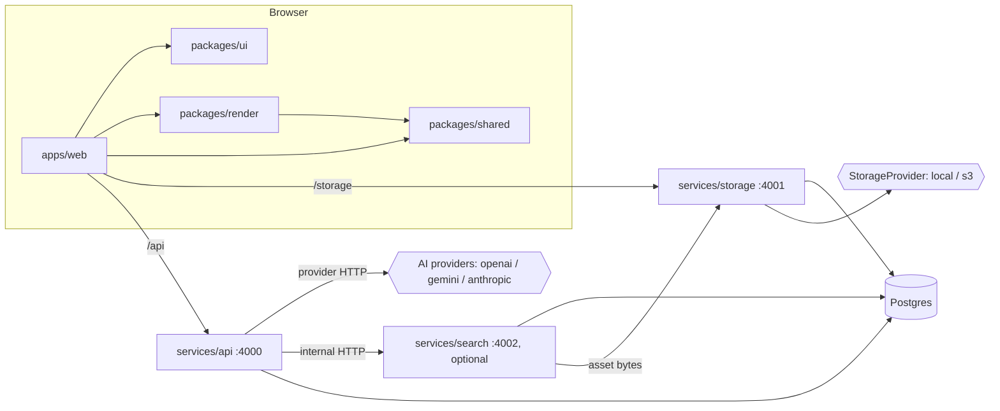
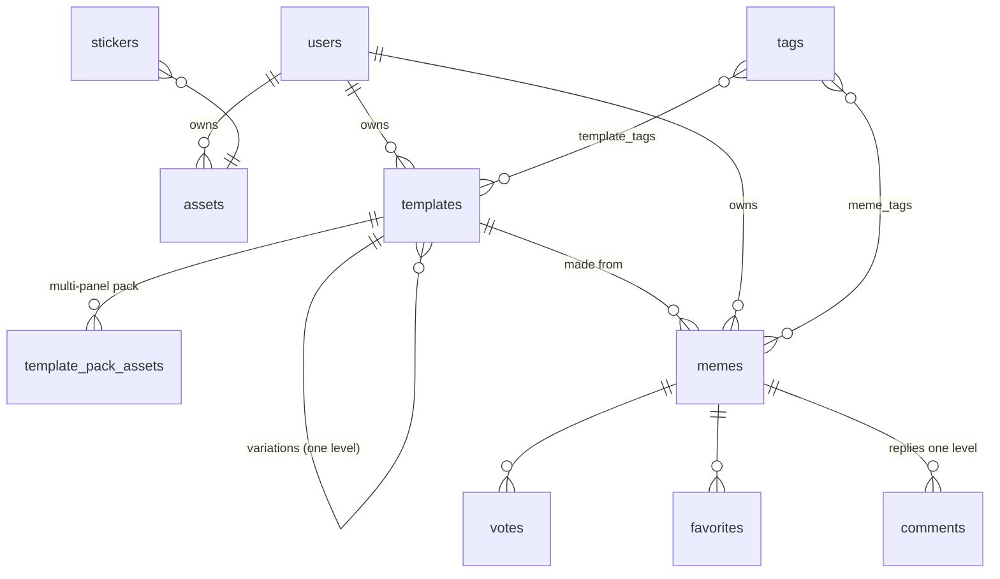

# memegen architecture

High-level system design: modules, how they connect, and the decisions that shape them. Setup and commands: [README.md](README.md). Rules for changing the repo: [AGENTS.md](AGENTS.md). Exact types live in `packages/shared`; this doc names them but does not repeat them.

## System overview

memegen is a React SPA backed by two small Node services, an optional search sidecar, and Postgres. The browser does all media work (decode, composite, encode). The servers store, validate, and index.

## Modules

| module | runs in | responsibility | depends on |
|---|---|---|---|
| `packages/shared` | browser + Node | Types, zod schemas, upload limits, pure layout/animation/panel logic, AI spec | — |
| `packages/render` | browser only | Decode → composite → encode for images, GIFs, video | shared |
| `packages/ui` | browser | Skinnable components and design tokens | — |
| `packages/server-kit` | Node | Config, Postgres, migrations, `AuthProvider`, HTTP helpers, asset rows, test helpers | shared |
| `services/storage` | Node | Asset upload/serve, content sniffing, probing, caps, storage providers | server-kit, shared |
| `services/api` | Node | Users, templates, memes, votes, comments, tags, stickers, stats, AI proxy | server-kit, shared |
| `services/search` | Node | Optional sidecar: CLIP embeddings of template images in a FAISS index (natural-language search, duplicate checks) | server-kit, shared |
| `apps/web` | browser | SPA: editor, template browser, gallery, profiles | ui, render, shared |
| `db/migrations` | Postgres | Append-only schema, applied in filename order | — |
| `scripts/` | Node/Bun | `run.sh` supervisor, seeds, snapshots, prod web server | all |
| `library/` | tooling + browser inspector | Built-in corpus, reviewed registry policy, ingestion, font descriptors, standalone preview | shared, server-kit; render in browser only |
| `e2e/` | Playwright | Browser specs against isolated DB and ports | — |

Dependency rules:

- `packages/shared` is the single source of truth for wire contracts. Request bodies and editor data derive from zod schemas; response interfaces describe the public row mappings. Internal search requests/responses are schema-validated at the HTTP boundary.
- Servers never import `packages/render`. API runtime code never imports `services/storage` (tests may, as a dev dependency); shared asset-row access lives in `server-kit`.
- Nothing imports `services/search`: the API reaches it over HTTP (`services/api/src/search.ts`), and it reads asset bytes over storage's HTTP API.
- Web `pages/` import from `components/`, never from each other.
- `scripts/check-boundaries.ts`, run by `typecheck`, enforces runtime workspace dependency directions, browser-compatible imports, public package entry points, and page independence. Integration tests may compose services.

## Key decisions

### Rendering is client-side

- Servers never decode or encode frames. `packages/render` handles stills (canvas → PNG/JPEG), GIFs (`gifuct-js` → `gifenc`), and MP4/MOV (`mediabunny`/WebCodecs → H.264, audio passed through).
- Preview equals output: the editor stage, loop preview, and every export use the same `layoutText`/`drawText` (shared) and `composeFrame` (render). The stage's handles and transparency checkerboard are DOM/CSS over the canvas, so its Preview box (beside a template's title) just drops them to show the finished meme.
- Layout is stored in fractions of the media, so it is resolution-independent; text is rasterized at the size shown or exported.
- Trade-off: export speed depends on the client. A server renderer could reuse the same TS without changing the data model.
- One exception, not rendering: the search sidecar decodes template images (a GIF's first frame) to embed them. It never encodes or serves media.

### Template search is an optional sidecar

- `services/search` runs only with `SEARCH_ENABLED=true`. It loads CLIP (`Xenova/clip-vit-base-patch32` via transformers.js / ONNX Runtime, downloaded into `SEARCH_DATA_DIR` on first start) and keeps every image/GIF template's unit-length embedding in a FAISS inner-product index (cosine similarity). Videos are found by name and tags only.
- Postgres stays the source of truth: every request first syncs the index with `templates`, embedding only images it hasn't seen and adding or removing only the templates that changed (no rebuild per change). Embeddings are keyed by the asset's sha256 and cached on disk, so restarts, snapshot loads, and re-uploads cost nothing. No migration or trigger is involved.
- The index (`services/search/src/vector-index.ts`) is exact brute force up to `EXACT_LIMIT` (50k) vectors, about 2 ms a query at that size, and an HNSW graph past it. Exact stays the default because HNSW misses some true top-20 text matches even on a few hundred templates (text queries sit off the image distribution the graph is built from); image-to-image (duplicate) lookups keep full recall. Neither FAISS index deletes by key, so removals are tombstones that searches skip; the index is rebuilt from live vectors once tombstones pass a quarter of them, and when it crosses `EXACT_LIMIT`. faiss-node can't set HNSW's `efSearch`, so recall is tuned by fetching at least 64 candidates.
- Text search: the query is embedded as the mean of several captions ("a photo of a dog", …), each image's similarity to a neutral caption is subtracted (busy, text-heavy images otherwise top every query), and matches are scored by z-score across the library. The subtraction is folded into the query (`query − baseline`), and the library's mean and spread come from running first and second moments of the vectors (O(d²) per query, exact), so only the top matches are scored. A query returns nothing unless its best match reaches `TEXT_MIN_TOP_Z`, then every match from `TEXT_MIN_Z`. Thresholds are starting points in `services/search/src/catalog.ts`.
- `GET /api/templates?q=` requires every whitespace-separated query word to match the template's name or inherited tags (case-insensitive substring matching across fields). Exact names rank first, then full-name phrases, then other all-word matches, with recency and ID breaking ties. Image search is a fallback only when no text matches exist, so semantic suggestions cannot broaden a successful refinement or crowd out exact names. An image match on a variation finds its top-level template; visibility and filters apply to both paths.
- Duplicates: `GET /api/templates/duplicates` lists templates with the same bytes (always), then image matches at cosine ≥ `DUPLICATE_MIN_SIMILARITY` (0.92: re-encodes and resizes score above, different pictures of one subject below). The Template Editor shows them before a new template is saved.
- `library duplicates` audits seeded images/GIFs with the same CLIP catalog and reports cosine ≥ 0.97 without mutating template identities or visibility. It distinguishes byte-identical media, same-family variants, and public cross-family candidates. CLIP decoding explicitly produces RGB pixels, including grayscale-alpha sources that the upstream loader cannot convert.
- Search is an extra: when the sidecar is off, slow, or failing, the API logs it and falls back to tags and names (text queries time out after 3 s).
- The transport is plain JSON over HTTP behind `X-Internal-Token`, like `/internal/*`; no web proxy forwards to it.

### Storage is pluggable and immutable

- `StorageProvider` (`put`/`get`/`delete`) with a registry; built-ins `local` and `s3`. Each asset row records its provider and key, so providers coexist.
- Asset content is immutable and served with Range support and immutable caching.
- Content type is sniffed from magic bytes, never trusted from the client.
- Upload caps (size, dimensions, frames per kind) default in `packages/shared/src/limits.ts`, take env overrides in `server-kit/src/config.ts`, are pre-checked by the client, and enforced by storage on every write, including rendered outputs. Probing is pure JS (no server ffmpeg).
- Scalar asset foreign keys and trigger-maintained `template_asset_references`/`meme_asset_references` protect every persisted image, font, and panel reference, including JSON content. Native FK locking arbitrates concurrent saves/deletes. Storage returns 409 for in-use deletion and removes provider bytes only after metadata deletion succeeds.

### Derived data lives in the database

Triggers keep derived state consistent across every write path (API, seeds, snapshot restore): template `kind`, default owners, vote tallies, usage logs (`template_uses`, `sticker_uses`), and hierarchy/reply-depth limits. Views handle tag inheritance. Consequence: snapshots are `pg_dump`s, not row replays.

API authoring commands own the transaction for a complete create/update/post, including tags and the author vote. Tag helpers use that transaction rather than committing independently. Database triggers still own derived state across all writers.

### Access rules are defined once

- Listing rules live in `services/api/src/rows.ts`, with the JS form `isListed` in shared. Meme visibility is `public | unlisted`; templates retain `isPublic`, where false means unlisted. All records, including drafts, open by direct link without ownership checks; media remains publicly addressable. Unlisted is a discovery preference, not confidentiality. Content mutation requires ownership or a server-resolved admin role; public discovery/social actions require a posted public meme, and related template variations remain listing-filtered. Public statistics retain their posted-only definition.
- Auth goes only through `AuthProvider` (`server-kit/src/auth.ts`), installed per service via `installAuth`; routes read `c.get("user")`. API and storage use the same configured provider. `AUTH_MODE=oidc` uses `openid-client` discovery and authorization code + S256 PKCE, state, nonce, and signed ID-token validation. Login requests only `openid`; provider access/ID/refresh tokens are never persisted or sent to the browser. `AUTH_MODE=dev` retains insecure username/header login exclusively with `MODE=dev`; production cannot select it or fall back to it.
- OIDC identities are keyed by verified issuer + subject in `auth_identities`. New identities get a unique generated username and no admin privileges; profile usernames/emails never claim existing accounts. Linking an existing account is an explicit trusted-operator action. `users.is_admin` defaults to false and stays database-owned; every authenticated request reads the current role. The browser fetches `/api/auth/config` before choosing its login UI, restores OIDC identity via `/api/auth/session`, and refreshes on focus. Browser-stored dev identities are discarded in OIDC mode.
- `auth_sessions` stores SHA-256 hashes of random 32-byte tokens, user IDs, and absolute expiration. HTTPS sessions use `__Host-memegen_session` (`Secure`, `HttpOnly`, `SameSite=Lax`, `Path=/`, no Domain); loopback development uses a separate nonsecure cookie. Login rotates the current session; logout deletes it and clears the cookie, but does not log out of the identity provider. Expired sessions never authenticate and are pruned on login. Ten-minute `auth_login_transactions` store hashed state/browser binding, PKCE verifier, nonce, and a validated local return route; callbacks atomically consume them before exchanging a code.
- OIDC state-changing requests require an exact `Origin` match to `PUBLIC_ORIGIN` on both API and storage. Intended internal bearer routes retain their separate authorization. Authentication responses are not cacheable; callback destinations come from configured origin rather than forwarded Host/proto headers. Production requires HTTPS for public origin, issuer, and discovered endpoints; HTTP is allowed only for development loopback. Auth startup fails closed on missing settings or discovery failures.
- Admin controls are separate from owner-only controls on post and template details. Admins can edit, publish, change visibility, and remove other users' content and delete comments. Template tag replacement is admin-only and preserves inherited tag provenance. The admin template review lists all dependent memes, including drafts, unlisted posts, and uses of variations, with individual and explicitly confirmed bulk removal. Template deletion returns 409 while dependents remain; it never implicitly deletes their posts. Template locks serialize dependency removal and template deletion against concurrent references. Removing posts/templates leaves stored media assets intact.
- Moderation stays on the entity's own controls; there is no standalone `/admin` page or global resource-deletion browser. Account deletion requires owned resources cleared first and protects self, the built-in account, and the last admin; account removals serialize before actor locking. Referenced assets return actionable 409s. Storage metadata deletion commits before provider-byte removal; a provider cleanup failure explicitly reports that metadata was already removed. The read-only admin audit API remains available independently of the statistics UI.
- Migration 020 adds append-only `admin_audit`. `deletionTransaction` reloads and locks the current actor/role and sets transaction-local audit context. Database triggers capture hard deletions, cascades, and comment soft deletions in the same transaction, including bulk removals. Records retain actor ID/name, action, resource kind/ID, label, a limited non-secret snapshot, and time; actor/target IDs deliberately have no foreign keys. UPDATE/DELETE/TRUNCATE are rejected and there are no API mutators. Database owners/superusers remain trusted because they can alter triggers/schema.
- Internal-only data (e.g. `negativeHScore`) is served under `/internal/*` behind `X-Internal-Token`, which no web proxy forwards.

### Feedback is a deployment connector

- `packages/shared/src/feedback.ts` owns feedback/report schemas and caps: 4,000 message characters, two PNG/JPEG/WebP screenshots of at most 2 MiB each, 6 MiB total multipart request. `/api/feedback/config` exposes availability only. Submission requires an authenticated user and exact configured Origin, even in dev; the fallback dev origin is `http://localhost:WEB_PORT`.
- The API bounds streamed bytes before multipart parsing, validates screenshot types through shared byte sniffing, renames files, and resolves report targets through existing direct-link access rules. Feedback kinds are bug/suggestion/hug; reports reference a meme/template and sex/drugs/violence/gore/other reason with optional text. Paths omit queries/fragments; reporter identity comes only from `AuthProvider`.
- `FEEDBACK_PROVIDER` selects email (SMTP/MIME attachments), Slack (bot message plus external file uploads in its thread), or a generic HTTPS webhook (JSON/base64 images, optional bearer token). Pure configuration validation runs at deployment preflight and API startup; production cannot disable the connector. Destinations/credentials are server-side, never selected by submitters or returned in errors.
- Delivery is synchronous and acknowledged only after the connector succeeds; failures return 502 or unconfigured 503 and preserve the browser draft. There is no queue or automatic retry, and multi-step Slack failures may leave partial delivery. Screenshots are not persisted as public assets or stored in a feedback table; retention belongs to the configured destination.
- The always-present feedback launcher offers a small Bug/Suggestion/Hug menu. Signed-in users get an automatic pre-dialog viewport capture, with form fields, private-marked regions, API key settings, iframes, and feedback UI omitted; screenshots are previewable/removable before explicit submission. Capture failure permits manual upload/text-only feedback. Signed-out users see a sign-in requirement without capture. Flag post/template buttons open an in-place reason/details modal using the same connector, without screenshots or route changes. Closing preserves the draft for that target and signed-in user; successful delivery followed by Done clears it. The former `/report/:kind/:id` page route is removed.

### Admin analytics uses UTC daily sign-ins and retained content

- Migration 021 adds `daily_user_logins`, keyed by UTC date and user UUID, plus a singleton `analytics_metadata` row recording when login tracking was installed. Successful dev sign-ins and verified OIDC callbacks insert in their authentication transaction with conflict deduplication. Session restoration, page requests, and failed sign-ins never count; this is unique sign-ins, not daily active users.
- Login history retains only date/UUID, not names, tokens, IPs, or request details. The UUID deliberately has no user foreign key so account deletion does not rewrite historical unique counts. No public endpoint exposes these rows; the admin API returns aggregates only.
- `GET /api/admin/analytics?days=7|30|90` defaults to 30 inclusive UTC calendar days and returns ascending, zero-filled daily buckets plus site-wide totals in one database snapshot. It requires the current server-resolved admin role and sets `Cache-Control: no-store`; no `negativeHScore` or account secrets are returned.
- Posts use `posted_at`, include public and unlisted posts, and exclude drafts. Templates use creation time and include variations/unlisted templates but exclude every template owned by the reserved `memegen` account. New-user/user totals exclude that account too. Comments exclude soft-deleted rows; storage totals sum all retained asset bytes, including assets left after content deletion.
- Content metrics describe records still retained, not lifetime creation events; deletions reduce both totals and the corresponding historical content buckets. Sign-in history cannot be reconstructed before tracking began: plots leave gaps for untracked dates, accessible details show “Not tracked”, and the first tracking day and today may be partial.
- An admin sees Admin immediately after API Keys on their own full-width profile (`?tab=admin`), showing only statistics: 7/30/90-day controls, totals with human-readable storage units, and responsive daily line plots with accessible per-date details. Plots use a shared count scale across five series and preserve untracked sign-in gaps. Other profiles/nonadmins do not render it or request analytics; server authorization independently protects the endpoint. Admin is not a sidebar or account-menu entry, and the old `?tab=analytics` selection falls back to Profile.

### AI is a stateless proxy

- The API forwards requests to the user's chosen provider with the user's own key (`X-AI-Key`) and stores nothing. Kept results re-enter as ordinary uploads, so caps, sniffing, and the template flow are unchanged.
- Providers are adapters in `services/api/src/ai/` behind `AiProvider` (text edits) and `AiImageProvider` (image edits), selected via a registry.
- Text edits use a versioned spec (`AI_EDIT_SPEC` in `packages/shared/src/ai.ts`): the model returns a list of actions (`UPDATE_IMAGE`, `ADD_TEXT`), which the server normalizes and the browser applies.
- Provider errors map to 422/429/502, never 401 (which the client treats as its own session ending).
- Provider keys and settings stay in the browser (`localStorage`).

### UI is skinnable

- All SPA UI is built from `@memegen/ui`; app styles read design tokens. `apps/web/src/styles.css` is the ordered entry point for feature-owned styles in `styles/`: shared app controls, intros, cards, statistics, Creator, shell layout, detail/profile, and editor.
- A skin is token overrides plus optional component replacements and layout hints. Only one arrangement renders at a time, so test IDs stay unique. Generic controls/tokens belong in UI; feature layout and presentation belong in web. See `packages/ui/README.md`.
- Dark mode is a per-skin variant (`Skin.dark`). Dark mode and card layout preferences are stored per user in web; UI owns applying the skin, not preference persistence.
- Built-in skins are `painted` (default, also production-locked), `basic`, and `google`. Painted alone uses the standout action gradient; other skins render those actions as ordinary primary buttons (Google's Create remains red). Google uses flat Material-inspired Google colors and neutral outline/filled vote icons. Card layout defaults to below-image details for Google and hover details otherwise; explicit per-user browser preferences take precedence.
- Profile tabs span the unused right rail. Post titles show a filled star only while favorited; the labeled Favorite toggle lives beside votes. Compact Share/Download actions align to the title. Painted's header-only SVG background is scaled by 20%, independent of font size and the sign-in logo.
- Media and panel editors retain separate workspace models. Quick Creator uses a panel template's default layout/style/panels, edits captions without flattening the pack, and passes the complete draft plus its typed title to the full editor. Media image generation retains the new-template confirmation flow.
- Quick Creator spans the gallery content width and caps its aspect-preserving preview at 28rem. Focusing its template search transfers control to the user immediately, so a delayed random starting-template response cannot replace text during entry.
- Panel-template authoring accepts whole-image uploads or a local sheet splitter. A drawn rectangle is stored in integer source-image pixels, independent of display scale; numeric fields provide keyboard/precision input. Shared `propagatedCrops` repeats right/down by crop extent plus a nonnegative pixel gap, excludes partial trailing rectangles, and rejects pack-capacity overflow without truncation. The browser previews numbered regions, validates source and every encoded PNG against upload caps, then uploads only the confirmed crops through existing storage and pack APIs. The original sheet and crop recipe are not persisted; resulting assets are immutable reusable pack images. Replacement/cancel releases decoded resources, and cancellation before applying performs no upload.
- App back hotkeys yield to text inputs, dialogs, dropdowns, and modifiers. `useBackGuard` protects unpublished meme editing against those hotkeys; it does not intercept the browser Back button.
- The standalone library inspector is tooling, not SPA UI. It deliberately supports offline `file://` metadata browsing without React or the UI package.

### Migrations are the schema version

Migrations are append-only and never edited once applied. Snapshots record their applied migrations; loading restores the snapshot schema, then migrates forward.

Migration 017 backfills JSON asset references and fails closed if existing content points at missing assets. Repair such content explicitly before retrying; migration never silently drops layers or substitutes fonts.

## Data model

- **Asset**: stored bytes (`image | gif | video | font`). All media, fonts, outputs, and stickers are assets.
- **Template**: base media plus default layers. `kind` is `single`, `gif` (GIF or video), or `multi` (a reusable image pack for user-customizable panel count, repetition, order, and layout). `multi` describes composition freedom, not the number of frames visible in a source image: fixed-format sequences such as Anakin/Padmé remain ordinary media templates. A pack's default panels are a starting arrangement, not a required count or one-use-per-image restriction. New media enters the system only as a template. Built-ins belong to the reserved `memegen` user.
- **Meme**: always made from a template; stores its own layers (or panels), source, and rendered output asset, so it can be re-edited. New memes and title edits need a non-blank title (`createMemeSchema`/`updateMemeSchema`); the editor and Quick Creator start it empty and require the user to enter it before saving or publishing, never deriving it from the template name. Memes saved before that may still be untitled and show as "Untitled". Saved = row exists; posted = `posted_at` set; listed = posted and public.
- **Layer**: discriminated union `text | image` sharing placement, opacity, a visibility window, and keyframes. Animation rules are pure functions in `packages/shared/src/animation.ts`.
- **Tag**: `topic | team`; memes inherit their template's tags, variations roll up to the parent.
- **Votes/stats**: one ±1 vote per user per meme; user stats and leaderboard share one SQL definition; badges are computed client-side from public stats. Each badge is one stat's tier (`BadgeDef.stat`, `.tier`, via `badgeFor`): a star in the tier's color (`--ui-color-tier-*`) follows that stat's figure everywhere (leaderboard, user search, profile), and profile stat tiles take the tier's color as their outline. The leaderboard's stat column headings are its sort buttons; `LEADERBOARD_SORTS` is in column order.

## Interfaces

All JSON unless noted. Errors: `{ error: string, details?: string[] }`. Shapes are the types in `packages/shared`.

### storage (`:4001`, web proxy `/storage`)

| route | purpose |
|---|---|
| `GET /health` | liveness |
| `GET /limits` | `UploadLimits` |
| `GET /providers` | default and available providers |
| `POST /assets` | multipart upload → `Asset`; 413/422 with cap violations |
| `GET /assets`, `GET /assets/:id` | list (by `kind`) / fetch `Asset` |
| `GET /assets/:id/content` | bytes, Range supported |
| `DELETE /assets/:id` | owner, admin, or internal token; 409 with reference details if in use; admin deletion audited |

### api (`:4000`, web proxy `/api`)

| area | routes |
|---|---|
| health | `GET /health` |
| auth/session/me | `GET /api/auth/config`, `GET /api/auth/session`, `GET /api/auth/login`, `GET /api/auth/callback` (last two OIDC-only), `POST /api/session` (dev-only), `DELETE /api/session`, `GET /api/me`, `GET /api/me/activity`, `GET /api/me/favorites` |
| users | `GET /api/users`, `GET /api/users/:username`, `GET /api/users/:username/memes`, `GET /api/users/:username/templates`, `GET /api/leaderboard` |
| templates | `GET/POST /api/templates` (`q` matches all words across names/tags, exact names first; images as fallback), `GET /api/templates/count`, `GET /api/templates/hot`, `GET /api/templates/duplicates`, `GET/PATCH/DELETE /api/templates/:id`, `GET /api/templates/:id/usage`, `POST/PUT /api/templates/:id/tags` (`PUT` admin-only) |
| admin | `GET/DELETE /api/admin/templates/:id/memes` (review/remove dependencies), `GET /api/admin/audit` (read-only), `DELETE /api/admin/tags/:id`, `DELETE /api/admin/stickers/:id`, `DELETE /api/admin/users/:id` |
| admin analytics | `GET /api/admin/analytics?days=7\|30\|90` (admin-only daily metrics and current totals; default 30 days) |
| memes | `POST /api/memes`, `GET/PATCH/DELETE /api/memes/:id`, `POST /api/memes/:id/post`, `PUT /api/memes/:id/vote`, `PUT /api/memes/:id/favorite` |
| comments | `GET/POST /api/memes/:id/comments`, `DELETE /api/comments/:id` |
| gallery | `GET /api/gallery` (period, sort, tag, search) |
| tags | `GET/POST /api/tags`, `GET /api/tags/:slug` |
| stickers | `GET/POST /api/stickers` |
| AI | `POST /api/ai/edit` (spec actions), `POST /api/ai/images` (image bytes); multipart, `X-AI-Key`, nothing stored |
| feedback | `GET /api/feedback/config` (availability), `POST /api/feedback` (authenticated multipart payload/screenshots → synchronous connector delivery; also content reports) |
| internal | `GET /internal/users/:username/stats` (`X-Internal-Token`) |

API layout: `app.ts` wires auth and errors; each `routes/*.ts` exports `register(app, …)` and owns authoring transaction boundaries. Guards live in `access.ts`, row mapping/listing predicates in `rows.ts`, transactional tag writes in `tags.ts`, template browse/search/duplicate queries in `template-queries.ts`, and usage analytics in `template-usage.ts`.

### search (`:4002`, optional, API only)

| route | purpose |
|---|---|
| `GET /health` | liveness and indexed template count |
| `POST /search` | `{ q, limit, candidates }` → `SearchHits` (z-scores), `X-Internal-Token` |
| `POST /similar` | `{ assetId, limit, candidates }` → `SearchHits` (cosine), `X-Internal-Token` |

`candidates` contains API-authorized `{ templateId, groupId }` pairs. The API owns visibility, filters, and variation-to-root grouping; the sidecar expands its ranked neighbor window until the requested number of eligible groups is found or the index is exhausted. Limits apply after eligibility/grouping, so hidden records and repeated variations cannot consume all result slots. The adapter validates `SearchHits`; malformed responses use the existing optional-search fallback.

## Runtime and config

- Node ≥ 24.2 runs server `.ts` via type stripping; Hono for HTTP; `postgres` (porsager) for SQL. Bun installs and runs scripts; Vite builds the web app.
- `run.sh <config> <command>` is the single entry point; configs are literal `KEY=value` files.
- `config/prod.env.example` is the deployment connector checklist: OIDC, PostgreSQL, local/S3 media, feedback/report delivery, public HTTPS, and internal token; semantic search and user-supplied AI are optional. `run.sh <config> deployment --options` shows connector choices and setup links; `deployment` validates local settings without network calls or printing secrets. `setup` validates before install/database changes; `start` validates before build/start. These checks do not certify connector credentials, connectivity, actual delivery, or backups.
- `scripts/run.ts` supervises migrate → storage → API → (search, when `SEARCH_ENABLED=true`) → web. The process list (`scripts/services.ts`) is shared with Playwright.
- Listener port parsing is environment-pure (`server-kit/ports`); process topology reads its supplied environment, not import-time global configuration. Test environment/port ownership lives in `e2e/environment.ts`.
- In prod, `scripts/serve-web.ts` serves the SPA and proxies `/api` and `/storage` (never `/internal`).
- `MODE` is baked into the web build; anything other than `dev` builds as prod. `MODE=prod` refuses destructive and dev-only commands and requires real secrets.
- `INTRO` (`basic` | `party` | `nyan`, default `basic`) is baked into the web build the same way and picks the sign-in page's intro; `vite.config.ts` fails the build on any other value. In dev, the sign-in page's dev tools preview the others (kept in `localStorage`, ignored in prod, like skins). Nyan cat is two images, the cat alone and one repeatable wave of rainbow: the rainbow is fixed in place and revealed behind the cat as it flies, so it can run any length and never slides.

## Data sets and snapshots

- One zip format (`scripts/snapshot.ts`) serves prod backups, the dev sample, and starter content: a manifest, a `pg_dump`, and asset bytes.
- Saves are read-only and consistent (one `repeatable read` transaction). Loads target a clean system, verify everything first, then restore and migrate.
- Datasets are committed as code, not dumps: mock (e2e), sample (dev), starter (shipped). Their memes are rendered at seed time by `@memegen/render` in headless Chromium.
- The sample seed requires `MODE=dev` before database access and upserts the local `bae` administrator before checking whether sample content already exists. Repeat runs preserve the account ID/name and re-grant its role; normal sign-in, starter seeding, and production do not bootstrap administrators.
- `library/` owns the built-in corpus, reviewed policy, ingestion, font vocabulary, and standalone inspector. `MANIFEST.json` holds canonical metadata/defaults; `REGISTRY_POLICY.json` holds terminal duplicate targets and rated aliases, not a second score table. Unknown checkout roots fail closed.
- One `library/seed.ts` coordinator owns argument/config resolution, registry loading, database lifetime, migration, and pre/final reconciliation. `import-checkout.ts` owns local fonts/root/variation acquisition; `import-manifest.ts` owns remote acquisition and byte deduplication. Source-specific conversion remains separate. Both sources can be independently disabled; disabling both skips reconciliation.
- Reconciliation runs even after partial import failure. It changes listing eligibility and seed-owned tags, never existing IDs, assets, default layers, variants, or saved memes. Over-ceiling/retired templates become unlisted, not inaccessible by direct link. Custom manifests cannot lower reviewed risks; aliases cannot bypass the configured risk ceiling. Imports remain resumable.
- Manifest media layouts compile to ordinary shared layers; `layout: "panels"` recipes compile normalized source-sheet crop regions and captions to the existing native panel contract. Ingestion crops still images in a lazy Playwright Chromium browser, exports individual PNG assets plus a native JPEG cover, then atomically inserts the template and ordered unique pack assets. Gallery and import share browser crop geometry; both use the real panel renderer. Flat and native panel identities remain distinct even when they share source bytes. `fonts.ts` owns browser-safe source/display/role descriptors; downloader, importers, preview, and server derive their font mappings from it. No server rendering or alternative editor contract is introduced.
- Panel recipes may declare `panels.additionalImages` as named standalone still-image URLs with provenance links. Browser validation enforces stillness and caps without re-encoding originals. These choices are excluded from default composition. Reseeding managed packs atomically appends missing assets while preserving cover/defaults, existing order/membership, and saved memes; advisory transaction locking serializes library imports. A normalized download-URL hash in the original asset filename makes completed uploads reusable after failure or on reseed. URL changes add immutable choices, not replacements; no API or database contract changes are required.
- Reviewed duplicate consolidation retains the higher-resolution canonical media and retires alternate discovery identities through terminal registry aliases. Blank is a single 2048×2048 pure-white JPEG with an empty text layer. Galaxy Brain discovery uses only its reusable four-image crop pack; former fixed sheets are unlisted without converting their rows or existing memes to panel content.
- The library server is loopback-only and serves a fixed allowlist of inspector data/code/fonts. The offline viewer validates enough to inspect metadata, not to certify an importable manifest; strict validation belongs to ingestion. Media/fonts remain outside the repository.
- Corpus editorial policy, source pinning, font/layout details, gallery operation, and maintenance commands live in [library/README.md](library/README.md), rather than being repeated here.

## Testing

- `node --test`: shared logic and service behavior via `app.request()` against a fresh `memegen_test`.
- Playwright application tests: real servers on separate ports against a fresh `memegen_e2e`, in branded Chrome (needed for H.264 in WebCodecs). AI calls hit a local stub (`startAiStub`). The search sidecar runs for real, with the model and embedding cache shared with dev.
- The standalone library project (`playwright.library.config.ts`) uses the real browser renderer and local fixtures, without app servers, database setup, or search. `scripts/e2e.ts` resolves test selection before infrastructure startup and runs both configs for the default command; an empty combined selection fails.
- Destructive test setup shares `assertDisposableDatabase`: exact dedicated database names, no main-database name collision, no target-override URL options, and no prod resets. E2E storage has an exact dedicated-directory guard. Snapshot tests validate both targets before resetting either.
- Search: API tests inject a `TemplateSearch` to pin ranking, visibility, and duplicate merging; sidecar tests run the real CLIP model against the test database.
