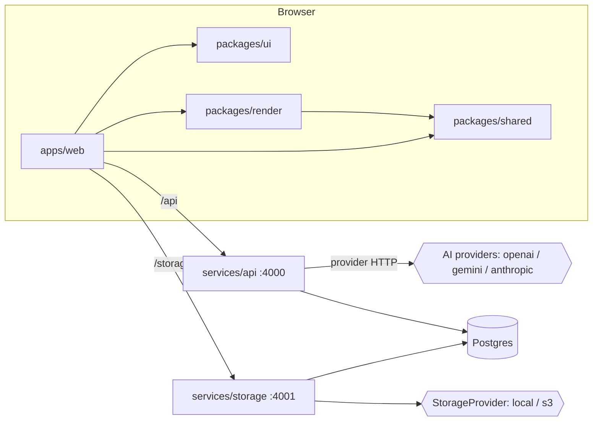
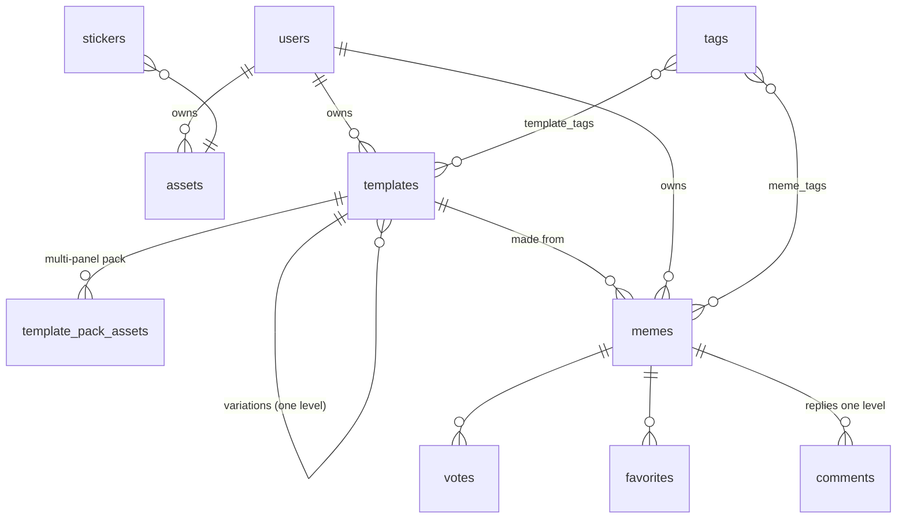

# memegen architecture

High-level system design: modules, how they connect, and the decisions that shape them. Setup and commands: [README.md](README.md). Rules for changing the repo: [AGENTS.md](AGENTS.md). Exact types live in `packages/shared`; this doc names them but does not repeat them.

## System overview

memegen is a React SPA backed by two small Node services and Postgres. The browser does all media work (decode, composite, encode). The servers store, validate, and index.

## Modules

| module | runs in | responsibility | depends on |
|---|---|---|---|
| `packages/shared` | browser + Node | Types, zod schemas, upload limits, pure layout/animation/panel logic, AI spec | — |
| `packages/render` | browser only | Decode → composite → encode for images, GIFs, video | shared |
| `packages/ui` | browser | Skinnable components and design tokens | — |
| `packages/server-kit` | Node | Config, Postgres, migrations, `AuthProvider`, HTTP helpers, asset rows, test helpers | shared |
| `services/storage` | Node | Asset upload/serve, content sniffing, probing, caps, storage providers | server-kit, shared |
| `services/api` | Node | Users, templates, memes, votes, comments, tags, stickers, stats, AI proxy | server-kit, shared |
| `apps/web` | browser | SPA: editor, template browser, gallery, profiles | ui, render, shared |
| `db/migrations` | Postgres | Append-only schema, applied in filename order | — |
| `scripts/` | Node/Bun | `run.sh` supervisor, seeds, snapshots, prod web server | all |
| `e2e/` | Playwright | Browser specs against isolated DB and ports | — |

Dependency rules:

- `packages/shared` is the single source of truth for contracts. Request bodies are `z.input` of its schemas, responses are `z.output`, so API, web, and e2e cannot drift.
- Servers never import `packages/render`. API runtime code never imports `services/storage` (tests may, as a dev dependency); shared asset-row access lives in `server-kit`.
- Web `pages/` import from `components/`, never from each other.

## Key decisions

### Rendering is client-side

- Servers never decode or encode frames. `packages/render` handles stills (canvas → PNG/JPEG), GIFs (`gifuct-js` → `gifenc`), and MP4/MOV (`mediabunny`/WebCodecs → H.264, audio passed through).
- Preview equals output: the editor stage, loop preview, and every export use the same `layoutText`/`drawText` (shared) and `composeFrame` (render).
- Layout is stored in fractions of the media, so it is resolution-independent; text is rasterized at the size shown or exported.
- Trade-off: export speed depends on the client. A server renderer could reuse the same TS without changing the data model.

### Storage is pluggable and immutable

- `StorageProvider` (`put`/`get`/`delete`) with a registry; built-ins `local` and `s3`. Each asset row records its provider and key, so providers coexist.
- Asset content is immutable and served with Range support and immutable caching.
- Content type is sniffed from magic bytes, never trusted from the client.
- Upload caps (size, dimensions, frames per kind) default in `packages/shared/src/limits.ts`, take env overrides in `server-kit/src/config.ts`, are pre-checked by the client, and enforced by storage on every write, including rendered outputs. Probing is pure JS (no server ffmpeg).

### Derived data lives in the database

Triggers keep derived state consistent across every write path (API, seeds, snapshot restore): template `kind`, default owners, vote tallies, usage logs (`template_uses`, `sticker_uses`), and hierarchy/reply-depth limits. Views handle tag inheritance. Consequence: snapshots are `pg_dump`s, not row replays.

### Access rules are defined once

- Visibility rules (listed, visible, openable) live in `services/api/src/rows.ts`, with the JS form `isListed` in shared.
- Auth goes only through `AuthProvider` (`server-kit/src/auth.ts`), installed per service via `installAuth`; routes read `c.get("user")`. The current `HeaderAuthProvider` (`X-User-Id`) is a placeholder and **not secure**; a real provider replaces it without touching routes.
- Internal-only data (e.g. `negativeHScore`) is served under `/internal/*` behind `X-Internal-Token`, which no web proxy forwards.

### AI is a stateless proxy

- The API forwards requests to the user's chosen provider with the user's own key (`X-AI-Key`) and stores nothing. Kept results re-enter as ordinary uploads, so caps, sniffing, and the template flow are unchanged.
- Providers are adapters in `services/api/src/ai/` behind `AiProvider` (text edits) and `AiImageProvider` (image edits), selected via a registry.
- Text edits use a versioned spec (`AI_EDIT_SPEC` in `packages/shared/src/ai.ts`): the model returns a list of actions (`UPDATE_IMAGE`, `ADD_TEXT`), which the server normalizes and the browser applies.
- Provider errors map to 422/429/502, never 401 (which the client treats as its own session ending).
- Provider keys and settings stay in the browser (`localStorage`).

### UI is skinnable

- All web UI is built from `@memegen/ui`; app CSS is layout-only and reads tokens.
- A skin is token overrides plus optional component replacements and layout hints. Only one arrangement renders at a time, so test ids stay unique. See `packages/ui/README.md`.

### Migrations are the schema version

Migrations are append-only and never edited once applied. Snapshots record their applied migrations; loading restores the snapshot schema, then migrates forward.

## Data model

- **Asset**: stored bytes (`image | gif | video | font`). All media, fonts, outputs, and stickers are assets.
- **Template**: base media plus default layers. `kind` is `single`, `gif` (GIF or video), or `multi` (an image pack laid out as panels). New media enters the system only as a template. Built-ins belong to the reserved `memegen` user.
- **Meme**: always made from a template; stores its own layers (or panels), source, and rendered output asset, so it can be re-edited. Saved = row exists; posted = `posted_at` set; listed = posted and public.
- **Layer**: discriminated union `text | image` sharing placement, opacity, a visibility window, and keyframes. Animation rules are pure functions in `packages/shared/src/animation.ts`.
- **Tag**: `topic | team`; memes inherit their template's tags, variations roll up to the parent.
- **Votes/stats**: one ±1 vote per user per meme; user stats and leaderboard share one SQL definition; badges are computed client-side from public stats.

## Interfaces

All JSON unless noted. Errors: `{ error: string, details?: string[] }`. Shapes are the types in `packages/shared`.

### storage (`:4001`, web proxy `/storage`)

| route | purpose |
|---|---|
| `GET /health` | liveness |
| `GET /limits` | `UploadLimits` |
| `GET /providers` | default and available providers |
| `POST /assets` | multipart upload → `Asset`; 413/422 with cap violations |
| `GET /assets`, `GET /assets/:id` | list (by `kind`) / fetch `Asset` |
| `GET /assets/:id/content` | bytes, Range supported |
| `DELETE /assets/:id` | owner or internal token; 409 if referenced |

### api (`:4000`, web proxy `/api`)

| area | routes |
|---|---|
| health | `GET /health` |
| session/me | `POST /api/session`, `GET /api/me`, `GET /api/me/activity`, `GET /api/me/favorites` |
| users | `GET /api/users`, `GET /api/users/:username`, `GET /api/users/:username/memes`, `GET /api/users/:username/templates`, `GET /api/leaderboard` |
| templates | `GET/POST /api/templates`, `GET /api/templates/count`, `GET /api/templates/hot`, `GET/PATCH/DELETE /api/templates/:id`, `GET /api/templates/:id/usage`, `POST /api/templates/:id/tags` |
| memes | `POST /api/memes`, `GET/PATCH/DELETE /api/memes/:id`, `POST /api/memes/:id/post`, `PUT /api/memes/:id/vote`, `PUT /api/memes/:id/favorite` |
| comments | `GET/POST /api/memes/:id/comments`, `DELETE /api/comments/:id` |
| gallery | `GET /api/gallery` (period, sort, tag, search) |
| tags | `GET/POST /api/tags`, `GET /api/tags/:slug` |
| stickers | `GET/POST /api/stickers` |
| AI | `POST /api/ai/edit` (spec actions), `POST /api/ai/images` (image bytes); multipart, `X-AI-Key`, nothing stored |
| internal | `GET /internal/users/:username/stats` (`X-Internal-Token`) |

API layout: `app.ts` wires auth and errors; each `routes/*.ts` exports a `register(app, …)`; shared guards in `access.ts`; row mapping and visibility in `rows.ts`.

## Runtime and config

- Node ≥ 24.2 runs server `.ts` via type stripping; Hono for HTTP; `postgres` (porsager) for SQL. Bun installs and runs scripts; Vite builds the web app.
- `run.sh <config> <command>` is the single entry point; configs are literal `KEY=value` files.
- `scripts/run.ts` supervises migrate → storage → API → web. The process list (`scripts/services.ts`) is shared with Playwright.
- In prod, `scripts/serve-web.ts` serves the SPA and proxies `/api` and `/storage` (never `/internal`).
- `MODE` is baked into the web build; anything other than `dev` builds as prod. `MODE=prod` refuses destructive and dev-only commands and requires real secrets.

## Data sets and snapshots

- One zip format (`scripts/snapshot.ts`) serves prod backups, the dev sample, and starter content: a manifest, a `pg_dump`, and asset bytes.
- Saves are read-only and consistent (one `repeatable read` transaction). Loads target a clean system, verify everything first, then restore and migrate.
- Datasets are committed as code, not dumps: mock (e2e), sample (dev), starter (shipped). Their memes are rendered at seed time by `@memegen/render` in headless Chromium.

## Testing

- `node --test`: shared logic and service behavior via `app.request()` against a fresh `memegen_test`.
- Playwright: real servers on separate ports against a fresh `memegen_e2e`, in branded Chrome (needed for H.264 in WebCodecs). AI calls hit a local stub (`startAiStub`).
