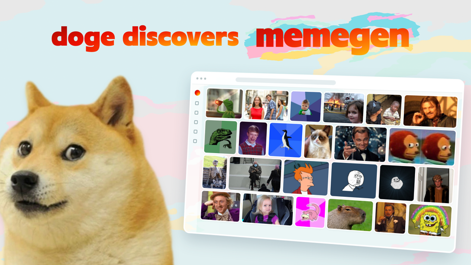

# memegen

**Make memes. Share them. Host it yourself.**

[Download the 42-second demo](https://media.githubusercontent.com/media/bryce-evans/memegen/main/docs/videos/memegen-intro.mp4)

## Features

- **Create:** templates, uploads, text, and stickers.
- **Animate:** GIFs, video, and keyframes.
- **Remix:** reusable, rearrangeable panels.
- **AI assist:** optional; bring your own key.
- **Share:** galleries, votes, comments, and favorites.
- **Self-host:** local or S3 storage, moderation, and backups.

## Setup overview

- Install Bun, Node.js, Git, and PostgreSQL.
- Clone the repo and configure Postgres.
- Install dependencies and seed templates.
- Start the server and create a meme.

**[Full setup guide](DEV_SETUP.md)** · [Production deployment](docs/OPERATIONS.md#deployment-setup)

---

[Architecture](ARCH.md) · [Operations](docs/OPERATIONS.md) · [Template library](library/README.md)
